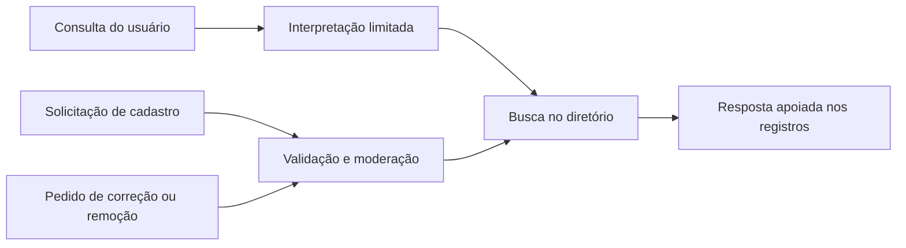

# Arquitetura de referência

Representação abstrata, sem workflows, contratos de integração ou dados do sistema de origem.

## Decisões a avaliar

O modelo de linguagem pode organizar a pergunta e a resposta, mas não deve ser fonte de fatos sobre um registro. Informação ausente precisa continuar ausente; instruções encontradas no conteúdo recuperado devem ser tratadas como dados não confiáveis.

Cadastros e reivindicações são operações distintas. O direito de editar um registro não deve resultar apenas de conhecer um dado que já é público. Publicação de mídia também exige validação independente da apresentação da interface.

## Roteiro de validação

- Consultar um assunto sem resultados e conferir a ausência de informações inventadas.
- Inserir instruções maliciosas em registros fictícios e verificar o limite da resposta.
- Tentar reivindicar um registro sem comprovação suficiente.
- Testar correção e remoção, incluindo referências derivadas.
- Conferir tratamento de arquivo inválido e acesso indevido à mídia.

Estes são critérios sugeridos de avaliação; não são resultados de um teste do agente ou do sistema privado.
